# OASYS — Operator-aware Assembly SYStem

### Digital Twin & Human-Centric Production Optimisation · NEMO Innovation Camp 2026


> **In one minute.** An automotive switch-panel assembly line loses capacity at two points: a firmware-flashing step with a fixed 20-second wait, and a manual, variant-heavy button-assembly step. We formalised the line in Scene2Model and BPMN, then built a discrete-event digital twin of it in AnyLogic. Running four flashing lanes in parallel and pooling three assembly stations under one multi-skilled operator cut the **average time between finished units from about 24 s to 13.3 s**, from roughly 150 to roughly 270 good units per hour. **OASYS** is our proposed next step: a human-centric resilience layer with a Human Digital Twin, an adaptive workforce and AI-enabled operator guidance.

<p align="center">
  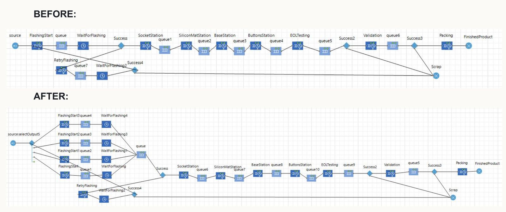
  <br><em>The two AnyLogic models in this repository: baseline (top) and optimised with four parallel flashing lanes (bottom).</em>
</p>

---

## Contents

- [What is implemented, evaluated and proposed](#what-is-implemented-evaluated-and-proposed)
- [The challenge](#the-challenge)
- [Production line](#production-line)
- [Bottleneck analysis](#bottleneck-analysis)
- [From process model to digital twin](#from-process-model-to-digital-twin)
- [Simulation model](#simulation-model)
- [Optimisation scenarios](#optimisation-scenarios)
- [Results](#results)
- [OASYS architecture (proposed)](#oasys-architecture-proposed)
- [Industry 5.0](#industry-50)
- [Repository structure](#repository-structure)
- [How to run the simulation](#how-to-run-the-simulation)
- [Technologies](#technologies)
- [Future work](#future-work)
- [NEMO Innovation Camp 2026](#nemo-innovation-camp-2026)
- [Team & acknowledgements](#team--acknowledgements)
- [References](#references)
- [License](#license)

---

## What is implemented, evaluated and proposed

This repository keeps three categories strictly apart.

| Category | Content | Evidence |
|---|---|---|
| ✅ **Implemented** | Discrete-event models of the line (baseline and optimised); flashing retry loop; quality gates and scrap paths; constrained operator resource pools; a shared multi-skilled operator pool (optimised model) | [`simulation/anylogic/`](simulation/anylogic/) |
| 📊 **Evaluated** | Parallel flashing (4 lanes, 3 flashing experts) plus the shared assembly-operator pool, compared with the baseline on time between finished units and operator utilisation | Presentation slide 11; reproduced by [`simulation/replication/`](simulation/replication/) |
| 💡 **Proposed** | OASYS: Human Digital Twin, a fully adaptive workforce, AI-enabled guidance, and classification, regression, forecasting and decision models | Presentation slides 12–18 (concept only, **no code**) |

> **Transparency note.** The presentation describes *"a second Buttons operator"* as one of the optimisations. The saved model files do not contain that change: the baseline has **2** Buttons operators at 6 s, and the optimised model has **1** Buttons operator at 12 s, which becomes its new bottleneck. The reported 13.3 s matches the files as saved. See [docs/optimization.md](docs/optimization.md#note-on-the-buttons-station).

---

## The challenge

NEMO 2026 *Disruptive Scenario 2, "5.0 Solution for Manufacturing Automation"*, describes an automotive factory with a multi-station production line, partially manual operations, variable cycle times and bottlenecks ([NEMO 2026 Programme Booklet](https://nemo.omilab.org/nemo/2026/docs/NEMO2026_Programme_Booklet.pdf)). Working Group 2 studied the line station by station and drew three conclusions:

- **Downstream operations depend on upstream release**, so a bottleneck does not stay local. It propagates through the whole line.
- **Manual work, operator stress and variant confusion** are part of the system design, not side effects.
- Improving throughput alone leaves the operator unsupported. *"Optimization got us a faster assembly line. The operator is still on their own."*

## Production line

The product is a switch-panel assembly. The route below uses the station names from the **AnyLogic models**; [docs/assembly-line.md](docs/assembly-line.md) maps them to the Scene2Model cards and BPMN tasks.

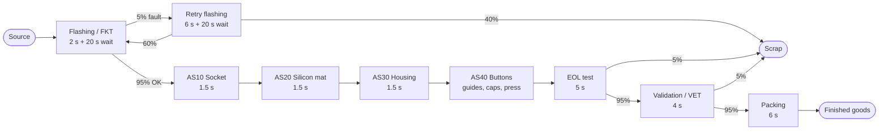

<p align="center">
  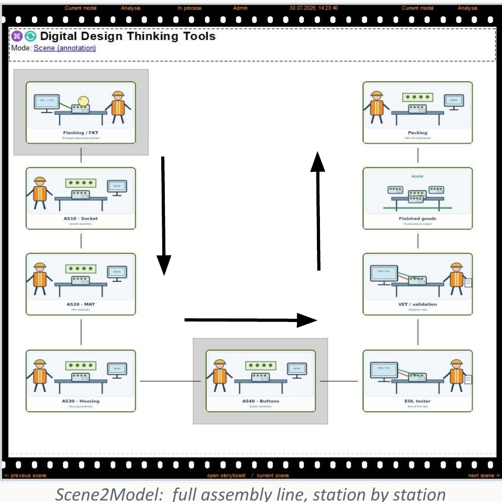
  <br><em>Scene2Model: the full assembly line, station by station (team artefact, slide 3).</em>
</p>

## Bottleneck analysis

| | Bottleneck I: Flashing / FKT | Bottleneck II: Buttons / AS40 |
|---|---|---|
| Nature | Time-demanding firmware download and test | Manual placement of light guides and button caps, then press |
| Driver | **Fixed 20-second wait** per controller, plus retries on failure | Changes with **every product variant**; blocked flow; operator stress |
| In the baseline model | 20 s wait with capacity 1, so at most one unit per ~20 s; flashing expert utilisation ≈ 1.0 | 2 operators × 6 s; utilisation ≈ 0.14 (starved by Flashing) |
| In the optimised model | 4 parallel lanes, no longer the constraint | 1 operator × 12 s; utilisation ≈ 1.0, **the new bottleneck** |

<p align="center">
  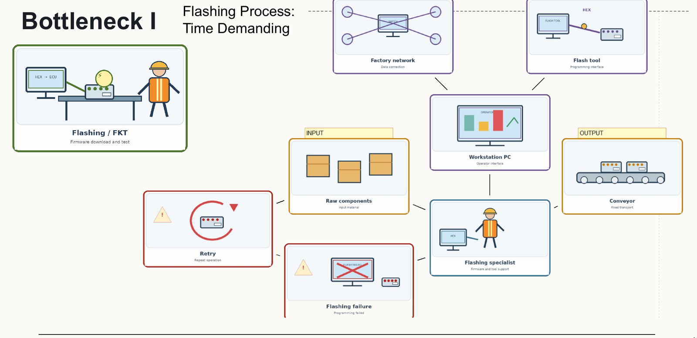
  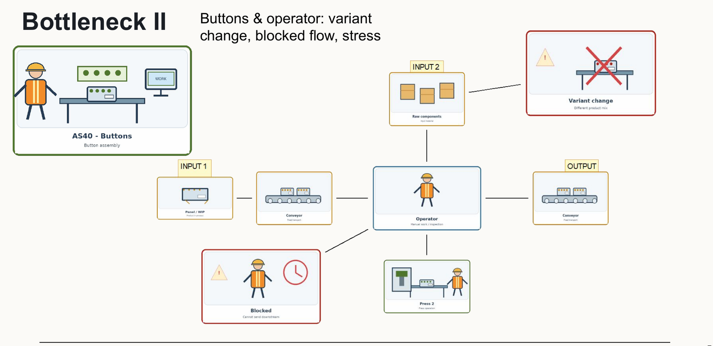
</p>

Details: [docs/bottleneck-analysis.md](docs/bottleneck-analysis.md).

## From process model to digital twin

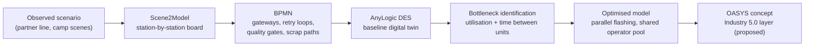

The BPMN model made the logic explicit: retry loops, quality gates and scrap paths. *"Every block here maps to a block in the model"* (team presentation, slide 6).

<p align="center">
  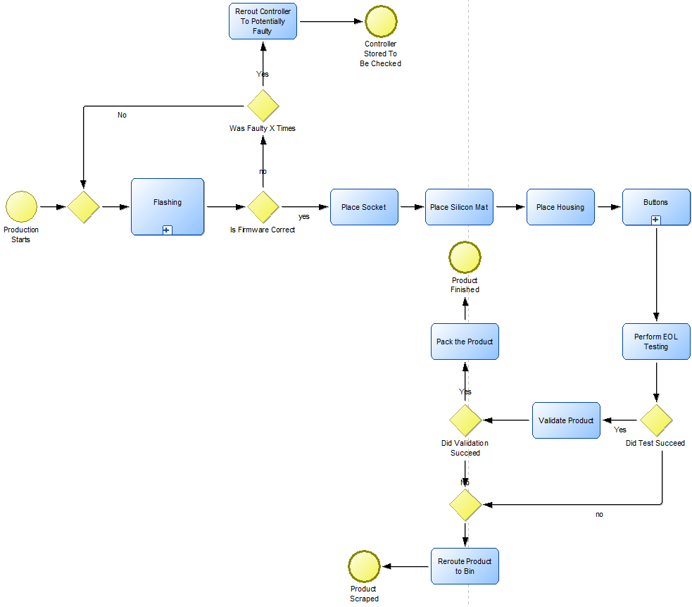
</p>

| Flashing sub-process | Buttons sub-process |
|---|---|
| 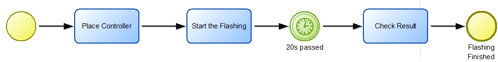 | 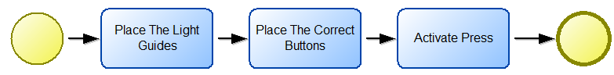 |

## Simulation model

Both models are self-contained AnyLogic 8.9.9 projects built with the standard **Process Modeling Library** (`Source`, `Service`, `Queue`, `Delay`, `SelectOutput`, `ResourcePool`, `Sink`). Model time unit: seconds.

| Element | Baseline [`NEMO.alp`](simulation/anylogic/baseline/NEMO.alp) | Optimised [`NEMO_Reworked.alp`](simulation/anylogic/optimised/NEMO_Reworked.alp) |
|---|---|---|
| Arrivals | AnyLogic default (1 unit/s): the line is **saturated** | same |
| Flashing | 1 lane: `FlashingStart` 2 s → `WaitForFlashing` 20 s | **4 lanes** (`selectOutput5`, 25% each) |
| Flashing experts | pool of 1 | **pool of 3** |
| Flashing quality gate | 95% pass; else `RetryFlashing` 6 s + 20 s wait; 60% re-enter, 40% scrap | same |
| Socket / Mat / Housing | 3 dedicated operators, 1.5 s each | **1 shared `MultiOperator`** for all three |
| Buttons | 2 operators, 6 s | 1 operator, 12 s |
| EOL test → Validation → Packing | 5 s (95%) → 4 s (95%) → 6 s | same |
| Output | `FinishedProduct` and `Scrap` sinks; utilisation bar chart | same |

Full description: [docs/simulation-methodology.md](docs/simulation-methodology.md).

## Optimisation scenarios

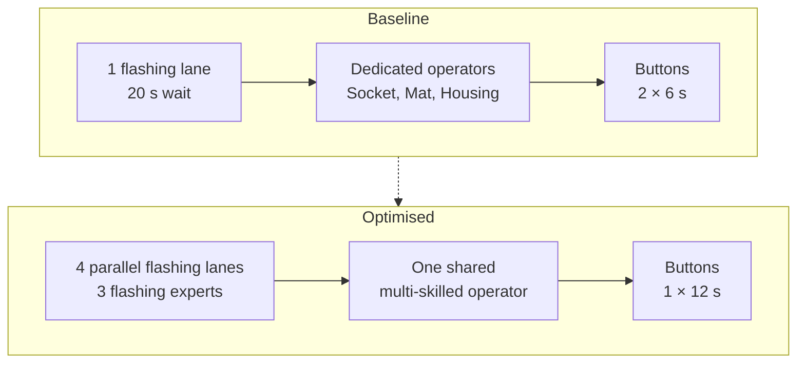

1. **Parallel flashing.** Four flashing lanes run concurrently, so the 20 s wait no longer limits the line.
2. **Shared operator pool.** One multi-skilled assembly operator covers AS10, AS20 and AS30, which were each under 10% utilised in the baseline.

See [docs/optimization.md](docs/optimization.md).

## Results

The presentation validates the optimisation with two metrics: **throughput** and **operator utilisation** (slides 10–11).

<p align="center">
  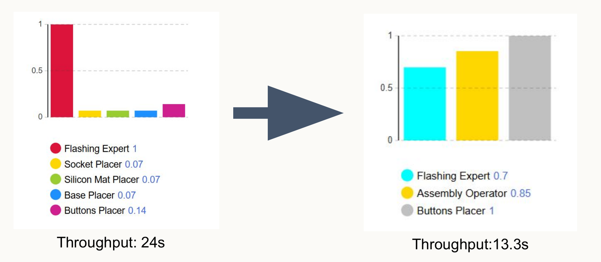
</p>

| Indicator | Baseline | Optimised | Source |
|---|---|---|---|
| **Average time between finished units** | **≈ 24 s** | **≈ 13.3 s** | Presentation slide 11 (labelled "Throughput") |
| Equivalent throughput (3600 ÷ value) | ≈ 150 units/h | ≈ 271 units/h | Derived |
| Flashing expert utilisation | 1.00 | 0.70 | Slide 11 |
| Socket / Mat / Base(Housing) operators | 0.07 / 0.07 / 0.07 | 0.85 (shared "assembly operator") | Slide 11 |
| Buttons operator utilisation | 0.14 | 1.00 | Slide 11 |

**What the 24 s → 13.3 s figure means.** The slide labels these values "Throughput" but gives them in seconds. Because the models are fed faster than they can produce, the value is the **mean interval between finished (good) units at the sink**, i.e. the inverse of the line's throughput. An independent re-implementation of both models ([`simulation/replication/`](simulation/replication/), 20 seeds) reproduces all five baseline and all three optimised utilisation values and gives **23.5 s** (baseline) and **13.3 s** (optimised). In the optimised model, 13.3 s ≈ 12 s ÷ (0.95 × 0.95): the 12 s Buttons cycle divided by the EOL and validation yields. See [results/results-summary.md](results/results-summary.md).

**Limits.** Processing times are deterministic modelling values chosen by the team during the camp, not measured factory data. Arrivals are not bounded, so work-in-progress and lead time grow without limit and are not meaningful indicators here. Results come from single AnyLogic simulation runs; the replication adds multi-seed confidence intervals.

## OASYS architecture (proposed)

> *"A closed loop that senses pressure, decides where support is needed and acts before performance deteriorates."* (team presentation, slide 13)

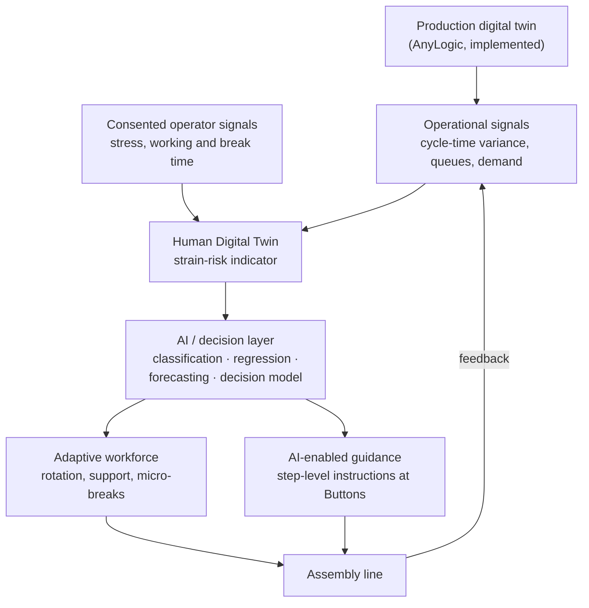

| Component | Idea | Status |
|---|---|---|
| **Human Digital Twin** | Combines consented wearable and workstation signals (stress, cycle-time variance, working and break time) into a strain-risk indicator; a regression model could predict dips in performance; supports smarter work/break schedules and dynamic breaks. **A decision signal, not a worker score.** | Proposed |
| **Adaptive workforce** | Operators form one multi-skilled, shareable pool; assignment follows demand to absorb peaks and avoid under-utilisation | **Partly implemented**: one shared operator for 3 stations in the optimised model. Dynamic, demand-driven assignment is proposed |
| **AI-enabled guidance** | Step-level visual guidance for variant-heavy button placement: fewer errors and less scrap, lower mental strain; *"knowledge lives in the station, not in one person"* | Proposed |

AI roles considered: **classification** (normal vs high-risk station or operator state), **regression** (future cycle time, throughput, performance deterioration), **forecasting** (demand, workload, production pressure), and a **decision model** (rotation, micro-breaks, extra support, AR guidance). None of these is implemented. Responsible-AI and worker-privacy considerations are in [docs/oasys-industry5.md](docs/oasys-industry5.md).

## Industry 5.0

The European Commission frames Industry 5.0 as research and innovation in service of a *sustainable, human-centric and resilient* European industry ([EC](https://research-and-innovation.ec.europa.eu/research-area/industrial-research-and-innovation/industry-50_en)). OASYS maps its **expected** contributions to those three dimensions. None of them has been tested experimentally.

| Human-centricity | Resilience | Sustainability |
|---|---|---|
| Reduced cognitive load at the station | Absorbs demand spikes | Less scrap and rework |
| Earlier relief before overload sets in | Handles variant changes | Fewer wasted labour-hours |
| Step-level / AR guidance | Covers absences; faster bottleneck recovery | Potentially lower energy per good unit |

## Repository structure

```text
.
├── README.md
├── LICENSE                     # all rights reserved; see notes on third-party material
├── CITATION.cff
├── simulation/
│   ├── anylogic/
│   │   ├── README.md           # how to open and run, block-by-block description
│   │   ├── baseline/NEMO.alp
│   │   └── optimised/NEMO_Reworked.alp
│   └── replication/
│       ├── README.md
│       └── replicate.py        # independent SimPy cross-check (not the digital twin)
├── models/bpmn/                # BPMN diagrams (exported images)
├── images/                     # Scene2Model board, bottleneck scenes, AnyLogic views, charts
├── results/results-summary.md  # reported and reproduced numbers, metric definitions
├── docs/                       # assembly line, methodology, bottlenecks, optimisation, OASYS, references
└── presentation/               # final team presentation (PDF)
```

## How to run the simulation

**Requirements:** [AnyLogic](https://www.anylogic.com/) 8.9.x. The models were saved with AnyLogic 8.9.9 and use only the standard Process Modeling Library; the free Personal Learning Edition is sufficient. Older AnyLogic versions may refuse to open files saved by a newer one.

1. Clone the repository (or download the two `.alp` files).
2. In AnyLogic: **File → Open…** and select
   - baseline: `simulation/anylogic/baseline/NEMO.alp`
   - optimised: `simulation/anylogic/optimised/NEMO_Reworked.alp`
3. In the **Projects** view, right-click the `Simulation` experiment → **Run**.
4. Watch the animated process flow and the **utilisation bar chart** under the resource pools. Click `FinishedProduct` (or inspect `FinishedProduct.count()`) to read output over model time.
5. The run never stops on its own (*Stop: Never*). Pause it after enough model time, e.g. ≥ 2 000 s, so that the line is past its warm-up.

There are no external data files, databases or result exports; all outputs are visible during the run. Step-by-step details and the block inventory are in [simulation/anylogic/README.md](simulation/anylogic/README.md).

**Without AnyLogic:** `pip install simpy && python simulation/replication/replicate.py` reproduces the key indicators of both models.

## Technologies

AnyLogic (discrete-event simulation, Process Modeling Library) · BPMN process modelling · Scene2Model (OMiLAB) · Python / SimPy (replication) · Mermaid · concepts: digital twin, human digital twin, Industry 5.0.

## Future work

- **Second Buttons operator in the optimised model.** Add it as an explicit scenario. The replication suggests the time between finished units would fall to about 6.6 s, but this has **not** been run in AnyLogic.
- Replace the assumed station times with measured data (distributions, not constants); bound arrivals to study WIP and lead time.
- Parameter-variation and optimisation experiments in AnyLogic instead of manual scenario comparison.
- Dynamic, demand-driven operator assignment (adaptive workforce) with shifts, breaks and absences.
- Human Digital Twin prototype from consented, aggregated signals, with a privacy-by-design review.
- Forecasting of demand and workload, and a decision model for rotation, micro-breaks and support.
- AI- or AR-assisted guidance at the Buttons station, evaluated on error and scrap rates.

## NEMO Innovation Camp 2026

The [NEMO2026 Innovation Camp](https://omilab.org/activities/events/nemo2026_innovationcamp/) ("AI in Disruptive Business Scenarios") was organised by **OMiLAB NPO** on 27–31 July 2026 in Chalkida, Greece. It was an intensive one-week programme on digital innovation that combined lectures with hands-on working sessions and led to a European certification on 5.0 innovation. NEMO 2026 is one of the events of the EU Erasmus+ project **[CoDEMO — Co-Creative Decision-Makers for 5.0 Organizations](https://omilab.org/activities/codemo/)** (project no. 101104819), which promotes green, resilient and human-oriented 5.0 organisations. Participants could earn the **CoDEMO 5.0 Certification** at Explorer level. Scenario 2, *"5.0 Solution for Manufacturing Automation"*, was owned by Marquardt and Lucian Blaga University of Sibiu ([Programme Booklet](https://nemo.omilab.org/nemo/2026/docs/NEMO2026_Programme_Booklet.pdf)).

## Team & acknowledgements

**Working Group 2:** Fabio Rota · Leandros Gerontakis · Shruti Edke · Elimy Ojeda

**Mentor:** Prof. Dr. Adrian Florea, Lucian Blaga University of Sibiu, Romania
**Facilitators:** Catalin Stan and Razvan Toghe, Marquardt Sibiu, Romania

We thank OMiLAB NPO and the NEMO 2026 organisers. The mentor and facilitators guided the scenario; they are not authors of this repository, and nothing here represents the views of Marquardt, Lucian Blaga University of Sibiu or OMiLAB. Repository maintained by Shruti Edke.

## References

See [docs/references.md](docs/references.md). Key sources:

- OMiLAB — [NEMO2026 Innovation Camp](https://omilab.org/activities/events/nemo2026_innovationcamp/) · [Programme Booklet](https://nemo.omilab.org/nemo/2026/docs/NEMO2026_Programme_Booklet.pdf) · [nemo.omilab.org](https://nemo.omilab.org/)
- [CoDEMO 5.0 project (OMiLAB)](https://omilab.org/activities/codemo/) · [codemo-project.eu](https://codemo-project.eu/)
- European Commission — [What is Industry 5.0?](https://research-and-innovation.ec.europa.eu/research-area/industrial-research-and-innovation/industry-50_en) · Breque, De Nul & Petridis (2021), [*Industry 5.0 — Towards a sustainable, human-centric and resilient European industry*](https://research-and-innovation.ec.europa.eu/knowledge-publications-tools-and-data/publications/all-publications/industry-50_en)
- OMiLAB — [Scene2Model](https://omilab.org/activities/scene2model)

## License

**All rights reserved.** This repository is published for academic and portfolio purposes; see [LICENSE](LICENSE). Viewing and citing are welcome. Reuse needs permission. Scenario context relates to industrial partner Marquardt and Lucian Blaga University of Sibiu; NEMO, OMiLAB and CoDEMO names and logos belong to their respective owners.
