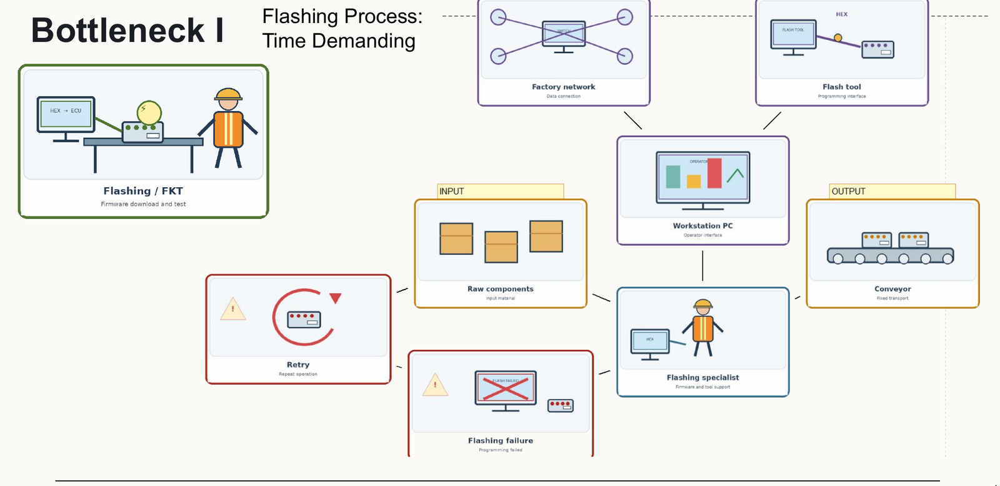
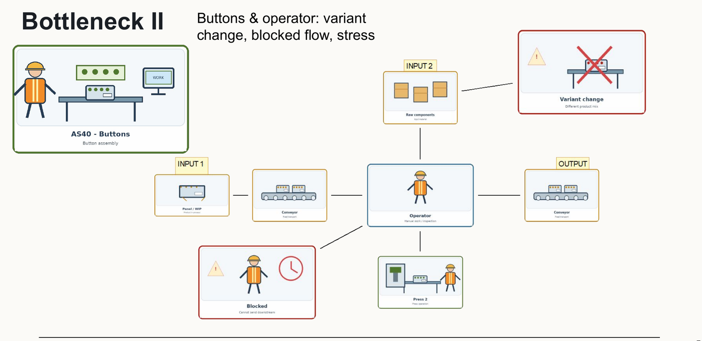

# Bottleneck analysis

[← back to README](../README.md)

The team identified two bottlenecks in the Scene2Model phase (slides 4–5) and decomposed both in BPMN (slide 7): *"Flashing is dominated by a fixed 20-second wait; Buttons by manual placement that changes with every variant."*

## Bottleneck I — Flashing / FKT

- **Process:** place controller → start flashing → **wait 20 s** → check result ([BPMN](../models/bpmn/flashing-subprocess-bpmn.png)).
- **Failure path:** a controller with wrong firmware is re-flashed. After repeated faults it is set aside for checking (BPMN) or scrapped (model: 40% of retried units).
- **In the baseline model** the 20 s `WaitForFlashing` delay has capacity 1. The line can therefore release at most about one controller every 20 s. Retries consume the same flashing resources.
- **Evidence:** in the baseline run, every downstream operator is idle more than 85% of the time (Socket, Mat and Housing ≈ 0.07, Buttons ≈ 0.14 utilisation) and the flashing expert is fully busy (1.0). That is the signature of an upstream bottleneck starving the line. (The expert's 1.0 also reflects the model's unbounded arrivals: new units keep queueing for the 2 s flashing step. The binding limit on output is the 20 s wait.)

## Bottleneck II — Buttons / AS40

- **Process:** place the light guides → place the correct buttons → activate the press ([BPMN](../models/bpmn/buttons-subprocess-bpmn.png)).
- **Why it matters:** the placement is manual and changes with every product variant. The scene highlights *variant change*, *blocked* flow and operator *stress*.
- **In the models** the human factors (variant confusion, stress, errors) are **not** simulated. Buttons is represented only by its processing time and operator capacity.
- **Evidence:** once Flashing is relieved in the optimised model, Buttons becomes the binding constraint (utilisation 1.0). This confirms the team's expectation that the manual, variant-heavy station is the next limit once the technical bottleneck is removed.

## Why this motivates OASYS

Removing the technical bottleneck moves the constraint onto a person. That observation is the bridge to the human-centric OASYS concept: the next gains depend on supporting the operator at the variant-heavy station, not only on adding machines. See [oasys-industry5.md](oasys-industry5.md).
