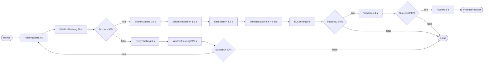

# Simulation methodology

[← back to README](../README.md)

## Modelling chain

1. **Scene2Model.** The team laid out the line as a station-by-station board and zoomed into the two bottleneck stations ([Scene2Model](https://omilab.org/activities/scene2model) is OMiLAB's tool for turning physical scene figures into conceptual models).
2. **BPMN.** The flow was formalised with explicit gateways (*firmware correct?*, *test succeeded?*, *validation succeeded?*), a flashing retry loop, quality gates and scrap paths. The two bottlenecks were decomposed into sub-processes.
3. **AnyLogic discrete-event model.** Each BPMN task became a Process Modeling Library block: tasks → `Service`, gateways → `SelectOutput`, end events → `Sink`, the timer event → `Delay`.
4. **Experimentation.** The baseline model was used to find the bottleneck from resource utilisation. The optimised model was then compared with it.

## Model facts (read from the `.alp` files)

| Property | Value |
|---|---|
| AnyLogic version | 8.9.9 (build 202607020720) |
| Libraries | Process Modeling Library (plus AnyLogic's standard markup library) |
| Model time unit | second |
| Experiment | one `Simulation` experiment, fixed random seed 1, real-time-scaled animation, stop = *Never* |
| Arrivals | `Source` with default settings: **1 unit per second** |
| Processing times | deterministic constants |
| Randomness | only in the quality gates (`SelectOutput` probabilities) and in lane choice (optimised) |
| Queues | unbounded (`maximumCapacity = true`) |
| `Delay` capacity | default (**1**) for every `WaitForFlashing*` block |
| Outputs | `FinishedProduct` and `Scrap` sinks; a bar chart of `ResourcePool.utilization()` |
| External files | none: each model is a single self-contained `.alp` |

### Consequences of these settings

- **Saturated line.** Arrivals (1/s) are far above line capacity, so the output rate equals the bottleneck capacity. That makes the setup suitable for measuring **maximum throughput** and **utilisation**.
- **WIP and lead time are not meaningful.** With unbounded arrivals and queues, the queue in front of the first station grows for as long as the model runs.
- **Little variability.** With constant times, results vary only through the 95% / 60% quality gates. A single run is therefore already stable; the replication confirms this with narrow confidence intervals.

## Baseline model logic

## Metrics

| Metric | Definition | How to read it in AnyLogic |
|---|---|---|
| **Time between finished units** (slides: "Throughput", in seconds) | elapsed model time ÷ units in `FinishedProduct` after warm-up | `FinishedProduct.count()` over model time |
| **Throughput** | finished units per hour = 3600 ÷ time between units | derived |
| **Operator utilisation** | share of time a resource-pool unit is busy | bar chart / `ResourcePool.utilization()` |

## Verification

[`simulation/replication/replicate.py`](../simulation/replication/replicate.py) re-implements both models in SimPy from the parameters above. It reproduces the utilisation values shown on the presentation's result slide, which supports both the parameter reading and the interpretation of the 24 s / 13.3 s indicator. It is a cross-check only; the AnyLogic models remain the digital twin.
