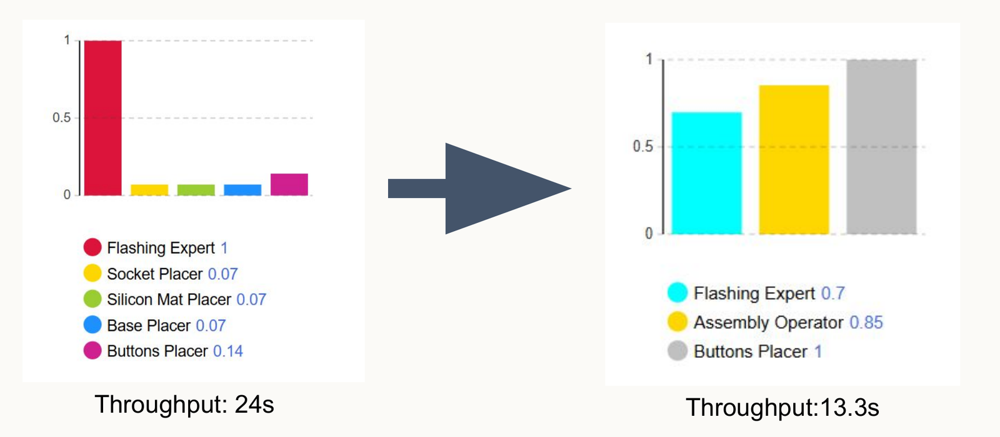

# Results summary

[← back to README](../README.md)

## Reported by the team (AnyLogic, presentation slide 11)

| Indicator | Baseline | Optimised |
|---|---|---|
| Indicator labelled "Throughput" | **24 s** | **13.3 s** |
| Flashing expert utilisation | 1 | 0.7 |
| Socket placer utilisation | 0.07 | — (merged) |
| Silicon mat placer utilisation | 0.07 | — (merged) |
| Base (housing) placer utilisation | 0.07 | — (merged) |
| Assembly operator (shared Socket/Mat/Housing) | — | 0.85 |
| Buttons placer utilisation | 0.14 | 1 |

## Interpretation of the 24 s / 13.3 s indicator

The slide labels the values "Throughput" but expresses them in seconds, while slide 10 defines throughput as *units completed per hour*. In both models arrivals exceed capacity, so the value is the **average time between finished (good) units at the `FinishedProduct` sink**, i.e. the reciprocal of throughput:

| | Baseline | Optimised | Change |
|---|---|---|---|
| Time between finished units | ≈ 24 s | ≈ 13.3 s | −45% |
| Throughput (3600 ÷ value) | ≈ 150 units/h | ≈ 271 units/h | ≈ +80% |

The percentages are derived arithmetic on the reported values.

**Analytical check (optimised).** Buttons runs at 100% with 12 s per unit, and 95% × 95% of units pass EOL and validation: 12 ÷ 0.9025 = **13.3 s**.

## Reproduced independently (SimPy, 20 seeds, ± = 95% CI)

| Indicator | Baseline | Optimised |
|---|---|---|
| Time between finished units | 23.5 s (±0.1) | 13.3 s (±0.1) |
| Throughput | 153 units/h (±1) | 271 units/h (±1) |
| Flashing expert | 1.00 | 0.69 |
| Socket / Mat / Housing operators | 0.07 / 0.07 / 0.07 | 0.86 (shared) |
| Buttons operator | 0.14 | 1.00 |

Every utilisation value on slide 11 is reproduced. The baseline replication gives 23.5 s against the reported ≈ 24 s; the gap is consistent with reading the value from a single, shorter animated run.

**Caveat on flashing-expert utilisation.** Because the `Source` keeps sending one unit per second, the flashing expert is always busy with the 2 s step in the baseline (1.0) and well loaded in the optimised model (≈ 0.7). These values reflect the unbounded arrivals as much as the line design.

## What is *not* in these results

- WIP, lead time and scrap rates: not reported (unbounded arrivals make WIP and lead time meaningless).
- Effects of operator stress, variant confusion or errors: not modelled.
- Any OASYS component (Human Digital Twin, AI guidance, forecasting): not implemented, hence no results.
