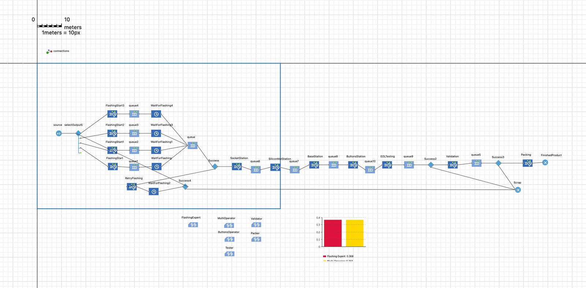

# AnyLogic models

These are the two working discrete-event models built by Working Group 2 at NEMO 2026. They are committed **unchanged**, byte-identical to the team's saved files; the only change is that `NEMO Reworked.alp` was renamed to `NEMO_Reworked.alp` to remove the space from the file name.

| Folder | File | AnyLogic model name | Java package | Scenario |
|---|---|---|---|---|
| `baseline/` | `NEMO.alp` | NEMO | `nemo` | current line |
| `optimised/` | `NEMO_Reworked.alp` | NEMO Reworked | `nemo_reworked` | parallel flashing + shared operator pool |

## Requirements

- **AnyLogic 8.9.x.** The files were saved with AnyLogic 8.9.9 (build 202607020720). Older 8.x releases may refuse to open them.
- Edition: any. Only the standard **Process Modeling Library** is used, which is included in the free Personal Learning Edition.
- No external files, databases, images or Java libraries are referenced.

## Run

1. Start AnyLogic → **File → Open…** → choose one of the `.alp` files. Because the two models use different Java packages, both can be open at the same time.
2. In the **Projects** panel, expand the model, right-click **Simulation** → **Run**.
3. The run is animated in real-time-scaled mode and never stops on its own. Speed it up with the run-speed control, or switch to *virtual time*.
4. **Read the results:**
   - **Operator utilisation:** bar chart below the resource pools (`ResourcePool.utilization()`).
   - **Output:** click `FinishedProduct` during the run to inspect `count()`. Time between finished units = model time ÷ count (use the count increase after a warm-up of ≈ 2 000 s).
   - **Scrap:** click `Scrap`.
5. To compare scenarios, run each model separately and read the same indicators.

## Block inventory

### Baseline — `NEMO.alp`

| Block | Type | Parameters |
|---|---|---|
| `source` | Source | defaults (1 arrival/s) |
| `FlashingStart` | Service | 2 s, `FlashingExpert` |
| `queue` → `WaitForFlashing` | Queue → Delay | 20 s, capacity 1 |
| `Success` | SelectOutput | p = 0.95 → `SocketStation`, else `RetryFlashing` |
| `RetryFlashing` → `queue7` → `WaitForFlashing2` | Service → Queue → Delay | 6 s (`FlashingExpert`), 20 s |
| `Success4` | SelectOutput | p = 0.60 → back to `FlashingStart`, else `Scrap` |
| `SocketStation` | Service | 1.5 s, `SocketOperator` |
| `SiliconMatStation` | Service | 1.5 s, `SiliconMatOperator` |
| `BaseStation` (housing) | Service | 1.5 s, `BaseOperator` |
| `ButtonsStation` | Service | 6 s, `ButtonsOperator` (**capacity 2**) |
| `EOLTesting` → `Success2` | Service → SelectOutput | 5 s (`Tester`); p = 0.95 |
| `Validation` → `Success3` | Service → SelectOutput | 4 s (`Validator`); p = 0.95 |
| `Packing` | Service | 6 s, `Packer` |
| `FinishedProduct`, `Scrap` | Sink | — |
| `chart` | Bar chart | utilisation of resource pools |

All resource pools have capacity 1 unless noted. Queues between stations are unbounded.

### Optimised — `NEMO_Reworked.alp` (differences only)

| Block | Change |
|---|---|
| `selectOutput5` | new: splits arrivals over 4 flashing lanes (p = 0.25 each); retried units re-enter here |
| `FlashingStart`, `FlashingStart1..3` + `WaitForFlashing`, `WaitForFlashing1`, `WaitForFlashing3`, `WaitForFlashing4` | 4 parallel lanes (2 s + 20 s each); outputs merge into `queue` → `Success` |
| `FlashingExpert` | **capacity 3** |
| `MultiOperator` | new pool (capacity 1) shared by `SocketStation`, `SiliconMatStation`, `BaseStation`; replaces the three dedicated operators |
| `ButtonsStation` / `ButtonsOperator` | **12 s, capacity 1** (see [docs/optimization.md](../../docs/optimization.md#note-on-the-buttons-station)) |

## Reproducibility notes

- The experiment uses a fixed seed (1). Re-running gives the same trajectory.
- Times are deterministic team estimates, not measured factory data.
- No result files are written; results are read interactively. Reported values are on presentation slide 11 and in [results/results-summary.md](../../results/results-summary.md).
